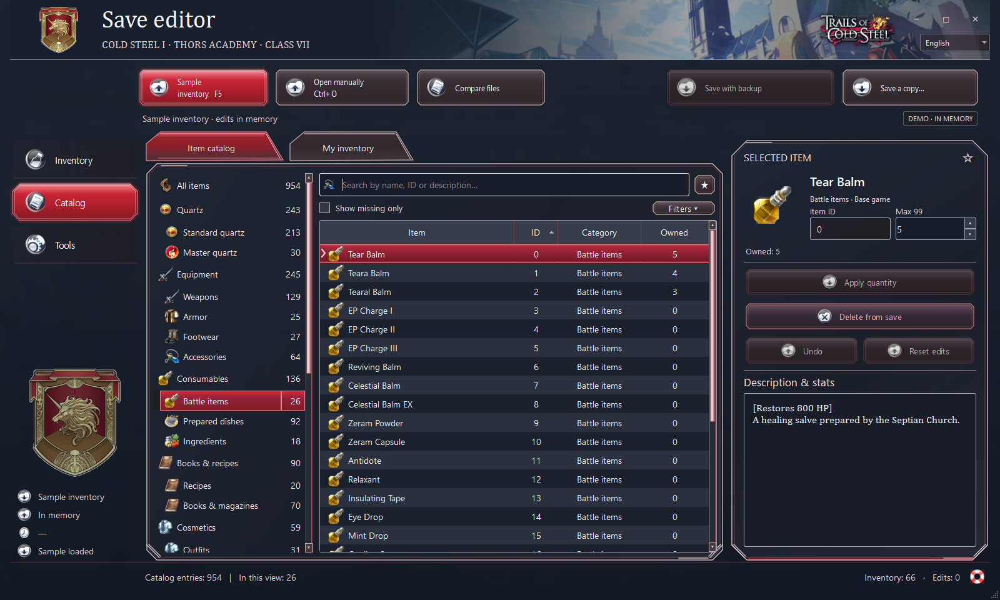
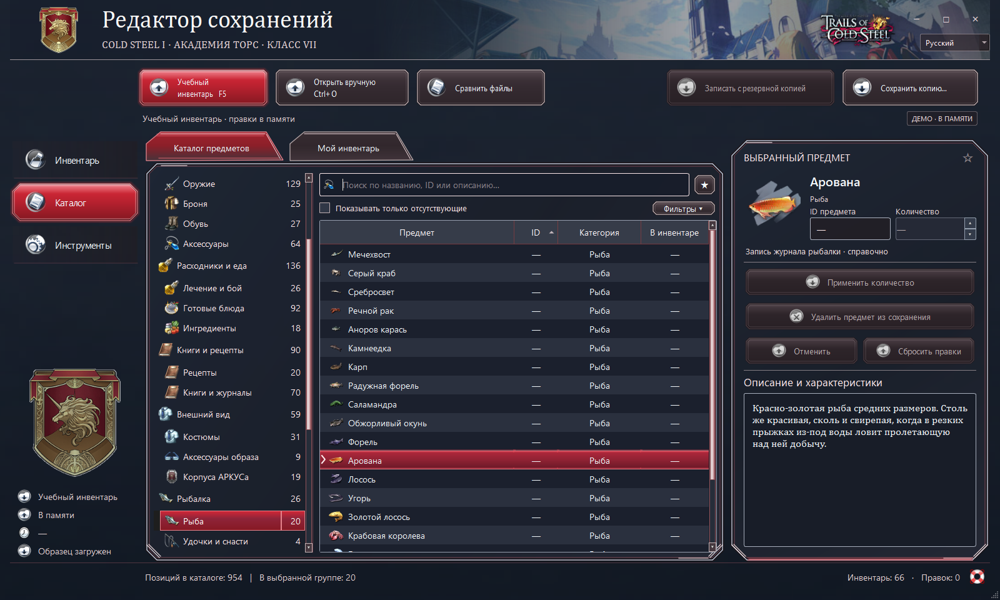

# Cold Steel I Inventory Editor

[](https://github.com/Sqzzzzzzz/Cold-Steel-Save-Editor/actions/workflows/windows.yml)
[](https://github.com/Sqzzzzzzz/Cold-Steel-Save-Editor/releases/latest)
[](LICENSE)

A Windows inventory editor for **The Legend of Heroes: Trails of Cold Steel I** on PC (Steam). Browse the installed game's catalog, review edits before writing, and keep a byte-for-byte backup of the original slot.





*Both screenshots show the interface on the main branch with the editor's in-memory demo inventory.*

## Features

- Search by name, ID or description. Filter by category, ownership and source, and sort the catalog or inventory.
- Add items, change quantities, remove items and apply supported changes to multiple selections. Review, undo or reset edits before saving.
- Open the most recent compatible save, compare inventory counts between two saves, and export the inventory to CSV.
- Save a separate copy or overwrite the current slot with a timestamped backup.
- Switch the interface, item names and descriptions between English and Russian.
- Browse fishing records and DLC listings from the game's tables. Entries such as fishing journal records, DLC packs and equipped master quartz have editing restrictions.

## Requirements and installation

- 64-bit Windows 10 or 11. The Windows build includes Python and Qt.
- The Steam PC installation of **Trails of Cold Steel I**, with its item table at `data/text/dat_us/t_item.tbl`.
- A version-8 XSEED PC save (460,992 bytes) for inventory editing. Other games, console saves and other PC editions are outside the verified scope.

[Download the Windows x64 ZIP with a single EXE](https://github.com/Sqzzzzzzz/Cold-Steel-Save-Editor/releases/download/v1.0.1/Cold-Steel-I-Inventory-Editor-v1.0.1-windows-x64-onefile.zip). Extract `Cold_Steel_I_Inventory_Editor.exe` and run it. To verify the archive, compare `Get-FileHash -Algorithm SHA256 <archive.zip>` with the [SHA-256 checksum](https://github.com/Sqzzzzzzz/Cold-Steel-Save-Editor/releases/download/v1.0.1/SHA256SUMS-onefile.txt).

The EXE includes the theme, original game artwork and bilingual item text. The editor reads item IDs and limits from your Steam installation.

## Using the editor

1. Start the editor. If Steam detection does not find the game, use **Tools → Scan game folder** and select the directory containing `ed8.exe`.
2. Use **Latest save** (F5) or **Open manually** (Ctrl+O). The latest-save search uses the Windows Saved Games folder under `Falcom\ed8`, or the last folder you opened. It checks slot names such as `save019.dat` and `autosave00.dat`, skipping incompatible files.
3. In **Item catalog** or **My inventory**, select a row. Enter the desired quantity and choose **Apply quantity**. You can remove an item with **Delete from save**. These actions edit the in-memory inventory.
4. Open **Review changes** to confirm the changes. Use **Save a copy** (Ctrl+S) to create a new `.dat`, or **Save with backup** to update the open slot. Close the game before overwriting a slot.
5. Use the language selector in the top bar to switch between English and Russian.

### Backups and recovery

**Save with backup** checks whether the slot has changed since opening, creates `<slot>.<timestamp>.bak` beside the slot and writes the edited inventory. If a competing Windows replacement is detected, the editor reports the additional recovery file ending in `.displaced.bak`.

To restore a backup, open its `.bak` file with **Open manually** and use **Save a copy** to write it as a new `.dat`. To use the restored copy in the game, close the game, keep a separate copy of the target slot, then replace that existing slot file with the restored copy. An exported file does not create a new entry in the game's slot index.

## Troubleshooting

| Symptom | Check |
| --- | --- |
| Game directory not found | Choose the installation containing `ed8.exe` and `data/text/dat_us/t_item.tbl`. The editor also looks in additional libraries registered by Steam. |
| No compatible save found | Open a version-8 Steam slot manually. Files such as `sdslot.dat`, thumbnails and autosave sidecars are separate from the save slot. |
| Source changed or write access denied | Close the game, allow Steam Cloud to finish, and reopen the slot. You can also save a separate copy to a writable folder. |
| Item names are placeholders | In **Tools → Scan game folder**, select the Steam game directory and check that the catalog loads. |
| Game artwork is missing | Download the release ZIP again and run the extracted EXE. For the folder-based build, keep `_internal` next to the EXE. |

## Known limitations

- Editing is limited to the inventory block. The editor leaves progression, sepith balances, equipped master quartz, slot indexes and thumbnails alone.
- Structural validation covers the save header, file size and inventory records. It does not validate every field in the game state.
- DLC listings reflect the installed tables. The editor does not change Steam ownership or unlock packages.
- Some items share their native inventory icon.
- Windows builds are unsigned.

## Local artwork and item text

The complete theme is embedded in the single-file EXE. It loads from `_internal/assets` in the folder-based build and from `assets` when running from source. The backdrop uses a [Heimdallr image from Nihon Falcom](https://www.falcom.co.jp/sen/world/show/ss39_l.jpg). The bilingual catalog, `assets/item-text.json`, is a UTF-8 object with `en` and `ru` maps. Each map uses decimal item IDs or references such as `fish:0` and `dlc:25` as keys, with `[name, description]` as values.

To extract the supported menu and inventory art from your own installation for local use, run:

```powershell
python game_art.py "C:\Program Files (x86)\Steam\steamapps\common\Trails of Cold Steel" "C:\Tools\SenPatcher.exe"
```

The importer handles the menu, standard items, master quartz, game logo and Blade cards. The release asset list is in [build_preview.py](build_preview.py). The Russian item text is credited to [Zeru and the Sen no Kiseki translation project](https://steamcommunity.com/sharedfiles/filedetails/?id=2169950170).

## Build and test

Use 64-bit Python 3.14 on Windows.

```powershell
python -m venv .venv
.\.venv\Scripts\python.exe -m pip install -r requirements-build.txt
.\.venv\Scripts\python.exe -m unittest discover -v
.\.venv\Scripts\python.exe build_preview.py
.\.venv\Scripts\python.exe package_release.py --tag v1.0.1
.\.venv\Scripts\python.exe verify_package.py release/local --full-theme
```

For a Windows ZIP containing a single executable, add `--onefile` to the build, package and verification commands. Verify the single-file ZIP in `release/onefile`. This build extracts its runtime files to a temporary directory when it starts. It reads the catalog from the installed Steam game.

Installed-game UI tests run when the standard Steam installation is present. The Windows workflow also tests the GUI with synthetic records and starts the packaged executable with and without a synthetic save.

## License and credits

The editor code is distributed under the [MIT license](LICENSE). It builds on the [Cold Steel IV](https://github.com/Sqzzzzzzz/Cold-Steel-IV-Save-Editor) interface and earlier [Cold Steel III](https://github.com/Sqzzzzzzz/Cold-Steel-3-Inventory-Editor-RU-ENG-) editor work. Game artwork, text and trademarks belong to their respective owners. This is a fan project unaffiliated with Nihon Falcom, XSEED Games and Valve. See [third-party notices](third_party/README.md) for the runtime libraries.
